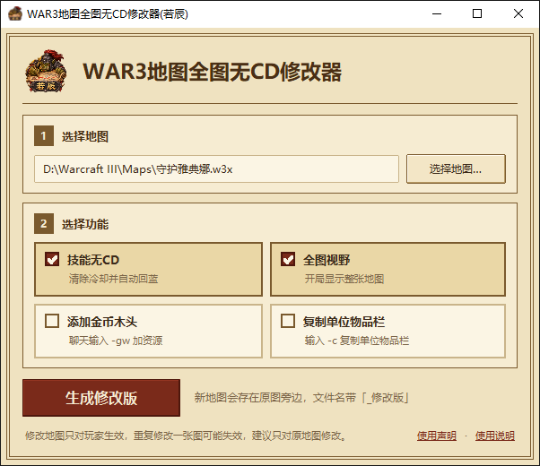
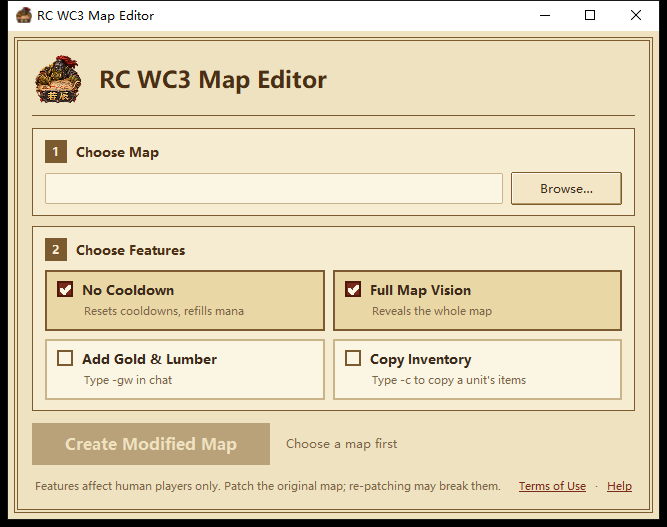

# 魔兽争霸3地图全图无CD修改器

**简体中文** | [English](#rc-wc3-map-editor)

**WAR3地图全图无CD修改器(若辰)** · RC WC3 Map Editor

本项目是一个免费的魔兽争霸3（WAR3）地图修改器，主要面向RPG地图。包含四个功能，技能无CD、全图视野、添加金币木头、复制单位物品栏。适用于 64 位 Windows 7 至 Windows 11，支持魔兽争霸3 1.20 至 1.27。

下载：[WAR3地图全图无CD修改器(若辰).exe](https://github.com/LiMingkun2000/rc-wc3-map-editor/raw/main/WAR3%E5%9C%B0%E5%9B%BE%E5%85%A8%E5%9B%BE%E6%97%A0CD%E4%BF%AE%E6%94%B9%E5%99%A8%28%E8%8B%A5%E8%BE%B0%29.exe)，英文版是 [RC WC3 Map Editor.exe](https://github.com/LiMingkun2000/rc-wc3-map-editor/raw/main/RC%20WC3%20Map%20Editor.exe)。双击即可使用。

工具直接修改本地地图文件。生成后，用这张地图开新对局，勾选的功能就会自动生效。

## 使用方法

1. 打开修改器，选择一张经典 JASS 格式的 `.w3x` 或 `.w3m` 地图（最大 64 MB）。
2. 勾选需要的功能。默认已勾选「技能无CD」（含自动回蓝）和「全图视野」。
3. 点击「生成修改版」。修改版保存在原地图旁边，文件名和游戏内的地图名都会加上 `_修改版`，原图不动。
4. 在游戏里选择修改版地图开新局，功能自动生效。输入 `-help` 可查看命令帮助。

## 可选功能

| 功能 | 游戏里的效果 |
| --- | --- |
| 技能无CD | 持续清除真人玩家存活单位的技能冷却，并把魔法恢复到上限。施法仍需满足技能的耗蓝要求。 |
| 全图视野 | 从开局起显示整张地图。隐身单位仍遵守游戏的侦测规则。 |
| 添加金币木头 | `-gw` 给自己加 10000 金币和 10000 木头。`-gw 500` 各加 500。只加金币用 `-g` 或 `-gold`，只加木头用 `-w` 或 `-wood`。 |
| 复制单位物品栏 | 选中任意单位输入 `-c` 或 `-copy`，再选自己的单位右键点空地，放下物品副本。 |

**建议只对原始地图修改**，重复修改同一张地图可能导致功能失效。

设置和地图备份保存在 `%LOCALAPPDATA%\War3MapHelper`。

## 使用建议与免责声明

- **请只在单机中使用。** 本工具是为单机（离线、单人）游戏娱乐做的，请勿在联机对战、KK 等对战平台、天梯、排位、比赛或其他多人游戏中使用它生成的地图。因违反平台规则受到的封号等处罚，由使用者自行承担。
- **地图版权归原作者。** 修改后的地图请仅供本人在本地使用，勿上传、再次发布或传播。
- **风险自负。** 本工具按现状免费提供，不作任何担保。地图或存档损坏、游戏账号被封禁或受到平台处罚、与地图作者或第三方产生的纠纷，均由使用者自行承担，作者不承担任何责任。使用前请自行备份原图和存档。
- **无关联。** 本工具为个人作品，与暴雪娱乐、网易及各对战平台均无关联，也未获得其授权。
## 许可

MIT，见 [LICENSE](docs/LICENSE)。

---

# RC WC3 Map Editor

[简体中文](#魔兽争霸3地图全图无cd修改器) | **English**

A free Warcraft III (WC3 / War3) map modifier, made mainly for RPG maps. It has four features: No Cooldown, Full Map Vision, Add Gold & Lumber and Copy Inventory. It runs on 64-bit Windows 7 to Windows 11 and supports Warcraft III 1.20 to 1.27.

Download: [RC WC3 Map Editor.exe](https://github.com/LiMingkun2000/rc-wc3-map-editor/raw/main/RC%20WC3%20Map%20Editor.exe). The Chinese build is [WAR3地图全图无CD修改器(若辰).exe](https://github.com/LiMingkun2000/rc-wc3-map-editor/raw/main/WAR3%E5%9C%B0%E5%9B%BE%E5%85%A8%E5%9B%BE%E6%97%A0CD%E4%BF%AE%E6%94%B9%E5%99%A8%28%E8%8B%A5%E8%BE%B0%29.exe). Double-click to run.

The tool patches a local map file. Start a new game on the patched map and the features you ticked are active.

## How to use

1. Open the tool and choose a classic JASS `.w3x` or `.w3m` map (up to 64 MB).
2. Tick the features you want. No Cooldown (with mana refill) and Full Map Vision are ticked by default.
3. Click **Create Modified Map**. The copy is saved next to the original, with `_modified` added to both the file name and the in-game map name. The original is left untouched.
4. Pick the modified map in the game and start a new game. The features work automatically. Type `-help` in chat to list the commands.

## Features

| Feature | Effect in game |
| --- | --- |
| No Cooldown | Keeps resetting ability cooldowns of living units owned by human players and refills their mana. Abilities still need enough mana to cast. |
| Full Map Vision | Reveals the whole map from the start. Invisible units still follow the normal detection rules. |
| Add Gold & Lumber | `-gw` gives you 10000 gold and 10000 lumber. `-gw 500` gives 500 of each. Use `-g` or `-gold` for gold only, and `-w` or `-wood` for lumber only. |
| Copy Inventory | Select any unit and type `-c` or `-copy`, then select a unit of your own and right-click the ground. Copies of the items are dropped there. |

All features apply to human players only. The amount for the resource commands is a whole number from 1 to 1000000.

**Patch the original map when you can**, as patching the same map again may break features.

## Compatibility

- 64-bit Windows 7 SP1 to Windows 11. On Windows 7 the Universal C Runtime is required; it comes with update KB2999226 or any Visual C++ 2015 or later redistributable.
- Classic JASS maps for Warcraft III 1.20 to 1.27, in MPQ v0 format. The added script only calls functions that existed before 1.20.

Not supported:

- Lua maps.
- Map formats newer than MPQ v0.
- Dual-script protection and multi-language script entries.
- Maps larger than 64 MB.
- Maps whose script uses functions added after 1.27. They fail validation and nothing is saved.
- Passing validation does not guarantee the map works in game. Test it in a new game.

Every map is processed on a temporary copy and validated before anything is written. Backups of overwritten copies and the settings are kept in `%LOCALAPPDATA%\War3MapHelper`.

## Recommended use and disclaimer

- **Please play single-player only.** The tool is made for entertainment in single-player (offline, solo) games. Please do not use the maps it creates in online play, on matchmaking platforms, in ladder, ranked or tournament games, or in other multiplayer games. Any penalty for breaking a platform's rules, such as an account ban, is your own responsibility.
- **Maps belong to their authors.** Please keep modified maps for your own local use and do not upload, republish or share them.
- **Use at your own risk.** The tool is provided free and as is, with no warranty. Damaged maps or saves, banned game accounts, platform penalties and disputes with map authors or third parties are your own responsibility; the author accepts no liability. Back up your maps and saves first.
- **No affiliation.** This is a personal project, not affiliated with or authorized by Blizzard Entertainment, NetEase or any game platform.
## License

MIT, see [LICENSE](docs/LICENSE).
